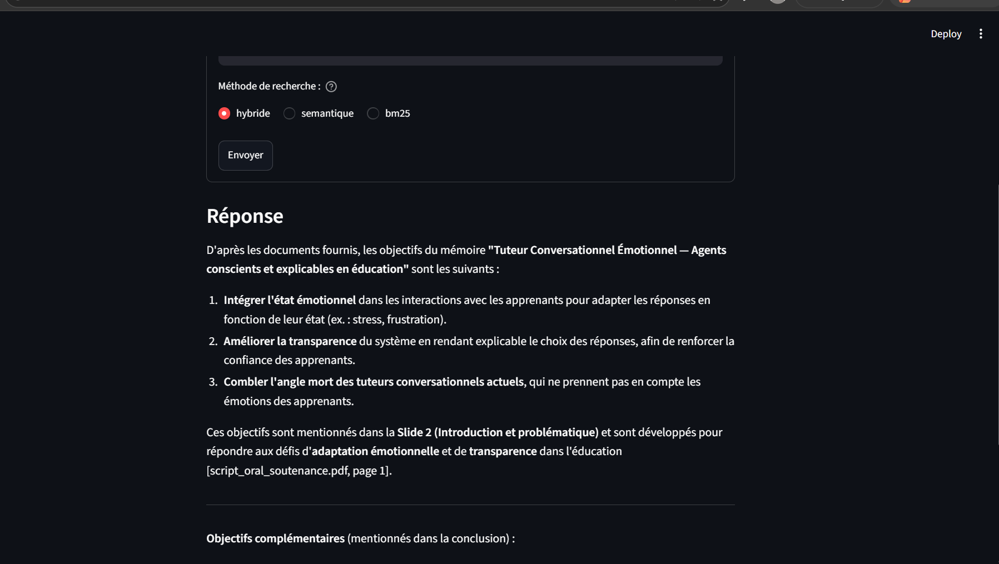
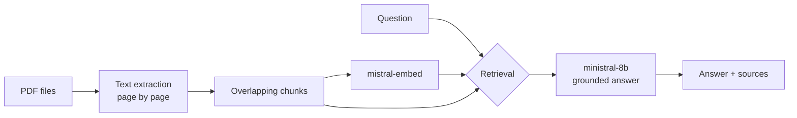
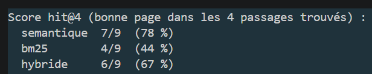

# Multilingual RAG Assistant with Mistral

A small web app that answers questions about your PDF documents in **French, English or Arabic**, using the **Mistral API**. Every answer is grounded in the retrieved passages and **cites its sources** (file + page). When the answer is not in the documents, the assistant says so instead of inventing one.



---

## 🧭 How it works



1. **Read** PDF files page by page (the page number is kept to cite sources)
2. **Chunk** the text into 200-word passages with a 40-word overlap
3. **Embed** each chunk with `mistral-embed`
4. **Retrieve** the 4 most relevant chunks, with 3 methods:
   - **semantic** search (cosine similarity between embeddings)
   - **keyword** search (BM25, implemented from scratch)
   - **hybrid** search (normalized 50/50 combination of both)
5. **Generate** an answer with `ministral-8b-latest` (temperature 0.2), instructed to answer **only** from the retrieved passages, to cite them as `[file, page]`, and to say it does not know otherwise

---

## 📊 Evaluation

`eval.py` measures retrieval quality on test questions (in French, English and Arabic) for which the correct page is known. It reports **hit@k**: is the correct page among the k retrieved passages?

```bash
python eval.py my_document.pdf
```

### Results (9 questions on a French document, k = 4)

| Method | hit@4 |
|---|---|
| **Semantic** | **7/9 (78 %)** |
| Hybrid | 6/9 (67 %) |
| BM25 (keywords) | 4/9 (44 %) |



### Analysis
- **Semantic search performs best**: it matches the *meaning* of the question, even when the wording differs from the text.
- **BM25 is weak in a multilingual setting**: it relies on exact word overlap, so English or Arabic questions cannot match keywords in a French document.
- **Hybrid search sits in between**: with a 50/50 weighting, it is pulled down by BM25 on cross-lingual questions.
- **Takeaway**: for multilingual question answering, semantic retrieval is the most robust; BM25 stays useful for exact terms (model names, figures) in the same language as the document.

---

## ⚙️ Engineering details

- **Rate limits**: handles HTTP 429 with throttling between calls and retries with exponential backoff
- **Cost control**: embeddings are sent in batches, questions are only sent on click, and repeated questions are cached
- **Security**: the API key is read from an environment variable and never stored in the code

---

## 🗂️ Project structure

| File | Role |
|---|---|
| `rag.py` | PDF reading, chunking, embeddings, retrieval (semantic / BM25 / hybrid), answer generation |
| `app.py` | Streamlit interface |
| `eval.py` | Retrieval evaluation (hit@k) |
| `requirements.txt` | Dependencies |

---

## 🚀 Run it

```bash
pip install -r requirements.txt
export MISTRAL_API_KEY="your_key"          # Windows PowerShell: $env:MISTRAL_API_KEY="your_key"
streamlit run app.py
```

---

## ⚠️ Limitations

- Scanned PDFs are not supported (no OCR)
- Tables and complex layouts are extracted as plain text
- Small evaluation set (9 questions): results are indicative only
- In-memory index: suited to a few documents, not to a large collection

## 🔭 Next steps

- Give more weight to semantic scores in the hybrid method, and evaluate on a larger multilingual question set
- Evaluate answer quality, not only retrieval (e.g. LLM-as-a-judge)
- Add a reranker and a vector database (FAISS or Chroma)
- Online demo (Streamlit Community Cloud)

---

## 👩‍💻 Author

**Sara Hadidi** – Master 2 in Natural Language Processing, Sorbonne Université
